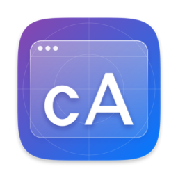
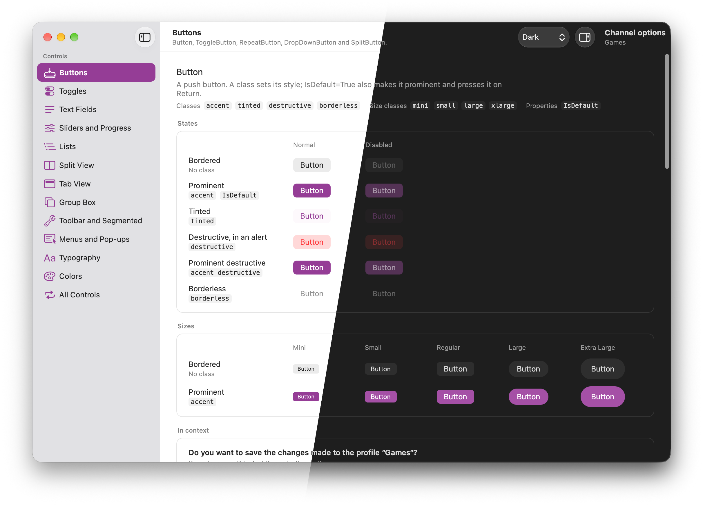

<p align="center">

</p>


# CupertinoAvalonia


[](https://www.nuget.org/packages/CupertinoAvalonia/)
[](https://github.com/Sorion/CupertinoAvalonia/actions/workflows/ci.yml)
[](https://avaloniaui.net)


Give your [Avalonia](https://avaloniaui.net) application a native macOS look.
Inspired by [FluentAvalonia](https://github.com/amwx/FluentAvalonia).

_Note: The theme is still in an early stage_

<p align="center">

</p>

## Introduction

CupertinoAvalonia tries to match the macOS 27 design system. It uses Apple's Figma file and screen captures of native apps as references. As such, a gap between Swift-made apps and this kit may appear. Liquid Glass elements are simulated in two ways:
- A custom Skia shader inspired by [LiquidGlassAvaloniaUI](https://github.com/KaranocaVe/LiquidGlassAvaloniaUI) and
  [LiquidAvalonia](https://github.com/A1isandr/LiquidAvalonia).
- Different layers to mimic some effects.


## Getting started

Add the package (`dotnet add package CupertinoAvalonia`), then use the theme instead of `FluentTheme` in
`App.axaml`:

```xml
<Application xmlns="https://github.com/avaloniaui"
             xmlns:ca="using:CupertinoAvalonia">
  <Application.Styles>
    <ca:CupertinoAvaloniaTheme />
  </Application.Styles>
</Application>
```

Light and dark follow `RequestedThemeVariant`; the accent follows System Settings (`CustomAccentColor` forces one).
On macOS, the accent, the selection, the focus ring and selected text (System Settings' highlight color) are AppKit's
own colors in both modes; elsewhere, and for a custom accent, their shades are derived from the accent.

## Controls

Avalonia's built-in controls take the macOS look as they are. Classes give the variants macOS has:

| Control | Classes |
|---|---|
| `Button`, `RepeatButton`, `ToggleButton` | `accent` (or `IsDefault`), `tinted`, `destructive`, `borderless` |
| `DropDownButton`, `SplitButton`, `ToggleSplitButton` | A button's classes |
| `TextBox` | `search` |
| `ComboBox` | `IsEditable="True"` for a combo box |
| `NumericUpDown` | `outside`: the stepper after the field |
| `ListBox` | `sidebar`, `accent`, `alternating`, `segmented` |
| `TreeView` | `sidebar`, `accent` |
| `ProgressBar` | `small`, `circular` |
| `Expander` | `button` |
| `SplitView` | `plain` |
| `TabControl` | `toolbar` |

`CheckBox`, `RadioButton`, `ToggleSwitch`, `Slider`, `GroupBox`, `AutoCompleteBox`, `ButtonSpinner`, menus, flyouts,
tooltips and scroll bars need no class. Other controls (date and time pickers, `Calendar`…) keep Fluent's templates in
Apple's colors.

- **Sizes:** `mini`, `small`, `large`, and `xlarge` on buttons, segmented controls and steppers.
- **Toolbar items:** `toolbar` on a button, a pop-up, a search field or a segmented control makes a Liquid Glass
  capsule; `compact` for a compact toolbar. A `Border` with `toolbar-group` puts several buttons in one capsule.
- **Text styles:** `TextBlock` classes `largeTitle`, `title1`…`title3`, `headline`, `body`, `callout`,
  `subheadline`, `footnote`, `caption1`, `caption2`, plus `emphasized`, `secondary`, `tertiary`.
- **Resources** are named after Apple's: `AccentBrush`, `LabelSecondaryBrush`, `WindowBackgroundBrush`…
- **Texts** are AppKit's English labels, as resources to redefine in your app's language:
  `CANavigationSplitViewHideSidebarText`, `CANavigationSplitViewShowSidebarText`, `SearchFieldClearButtonText`.

## Gallery

The Gallery shows every control in the theme, page by page, with the classes above:

```sh
dotnet run --project samples/CupertinoAvalonia.Gallery
```

## CAWindow

```xml
<cac:CAWindow xmlns="https://github.com/avaloniaui"
              xmlns:cac="using:CupertinoAvalonia.Controls"
              ExtendsContentIntoTitleBar="True"
              ToolbarStyle="Unified"
              Material="Sidebar">
```

A window with macOS's title bar (elsewhere, a plain `Window`):

- `ExtendsContentIntoTitleBar`: the content runs under the title bar. `WindowControlsInset` keeps it clear of the
  window controls.
- `ToolbarStyle`: `Unified` (52 pt) or `UnifiedCompact` (40 pt).
- `Material`: the material behind the window (`Sidebar`, `WindowBackground`, `UnderWindowBackground`, `HudWindow`).
- `AlwaysLooksActive`: keeps the active look while another window is active.

**Liquid Glass chrome:** macOS draws it only for apps built with a recent SDK, which .NET's app host doesn't declare.
The package declares macOS 27's SDK after each build on macOS (`CupertinoDeclareMacOSSdk=false` turns it off). With a
project reference, import `buildTransitive/CupertinoAvalonia.targets` in your app, as the Gallery does.

## CANavigationSplitView

A sidebar, a content with its own toolbar, and an optional inspector, as SwiftUI's `NavigationSplitView`:

```xml
<cac:CAWindow ExtendsContentIntoTitleBar="True" ToolbarStyle="Unified" Material="Sidebar" …>
  <cac:CANavigationSplitView IsSidebarOpen="{Binding IsSidebarOpen}">
    <cac:CANavigationSplitView.Sidebar>
      <ListBox Classes="sidebar" ItemsSource="{Binding Pages}" />
    </cac:CANavigationSplitView.Sidebar>
    <cac:CANavigationSplitView.ContentToolbar>
      <TextBlock Classes="headline" Text="{Binding Title}" VerticalAlignment="Center" />
    </cac:CANavigationSplitView.ContentToolbar>
    <ScrollViewer cac:CAToolbar.ScrollsUnder="True">
      <ContentControl Margin="20" Content="{Binding Page}" />
    </ScrollViewer>
  </cac:CANavigationSplitView>
</cac:CAWindow>
```

- `IsSidebarOpen`, `SidebarWidth` (220), `MinSidebarWidth`, `MaxSidebarWidth`: the sidebar opens, closes and resizes
  as on macOS 27, and folds away when dragged narrow.
- `Inspector`, `InspectorToolbar`, `IsInspectorOpen`, `InspectorWidth` (270): a column on the right, with its own part
  of the toolbar. Give `MinInspectorWidth` and `MaxInspectorWidth` to make it resizable.
- `ToggleSidebarGesture`, `ToggleInspectorGesture`: no shortcut by default, as in SwiftUI. The Gallery adds ⌃⌘S and
  ⌃⌘I in its View menu.

The Gallery's [MainWindow.axaml](https://github.com/Sorion/CupertinoAvalonia/blob/main/samples/CupertinoAvalonia.Gallery/Views/MainWindow.axaml)
is a complete example.

## CAToolbar

A toolbar laid over the content, as in macOS 27: transparent at rest, its background shows when the content scrolls
under it. `CANavigationSplitView` has one already.

```xml
<Panel>
  <ScrollViewer cac:CAToolbar.ScrollsUnder="True">
    <ContentControl Margin="20" Content="{Binding Page}" />
  </ScrollViewer>
  <cac:CAToolbar>
    <!-- toolbar items -->
  </cac:CAToolbar>
</Panel>
```

- `CAToolbar.ScrollsUnder="True"` on a scroll viewer starts its content below the toolbar and lets it scroll under.
- `CAToolbar.ContentInset` is the room the toolbar takes, for content that doesn't scroll.
- `BackgroundVisibility`: `Automatic` (default), `Visible` or `Hidden`.
- Buttons, pop-ups and segmented controls in it are toolbar items, without the `toolbar` class.

## CASymbolIcon

```xml
<Button Classes="toolbar">
  <cac:CASymbolIcon Symbol="square.and.arrow.up" />
</Button>
```

An SF Symbol by its name in Apple's catalog, at the size, weight and color of the text around it (`FontSize`,
`FontWeight`, `Foreground`); `SymbolScale="Large"` is the scale of toolbar items, which toolbar styles set.

- **On macOS 11 and later**, macOS draws its own symbol: the whole catalog is available. No font installed with
  macOS contains them, so the theme's chevrons, checkmarks and magnifying glass use them too.
- **Elsewhere**, about a hundred common symbols have a Fluent counterpart, from Segoe Fluent Icons on Windows or the
  package's embedded font (FluentAvalonia's, MIT). `FallbackGlyph` gives one for any other symbol
  (`FallbackGlyph="&#xE72D;"`), and `FallbackData` a drawing instead.

## Good to know

- The switch's and the slider's pressed knobs are real glass lenses (`Styling/GlassLens.cs`, a Skia shader
  inspired by [LiquidGlassAvaloniaUI](https://github.com/KaranocaVe/LiquidGlassAvaloniaUI) and
  [LiquidAvalonia](https://github.com/A1isandr/LiquidAvalonia)). Menus, popovers and sidebars aren't glass yet.
- Focus rings and lenses are drawn in the adorner layer so containers don't clip them:
  [docs/avalonia-clipping.md](https://github.com/Sorion/CupertinoAvalonia/blob/main/docs/avalonia-clipping.md) explains how, for any control.
- Avalonia lays out every weight of the system font with the regular weight's advances, so text, bold text most,
  renders tighter than on macOS. The text styles and controls add letter spacing to match; a `FontWeight` you set
  yourself keeps the regular spacing (prefer `emphasized`).
- On macOS, the theme tags every window as sRGB. Avalonia leaves the color space unset, so on a wide-gamut display
  (every recent Mac) colors looked more saturated than in native apps. Your own colors and images are affected too.
  Avalonia's [#21847](https://github.com/AvaloniaUI/Avalonia/pull/21847) proposes an option for it, which the theme
  will use once released.

## License

MIT, see [LICENSE](https://github.com/Sorion/CupertinoAvalonia/blob/main/LICENSE) and [THIRD-PARTY-NOTICES.md](https://github.com/Sorion/CupertinoAvalonia/blob/main/THIRD-PARTY-NOTICES.md).
